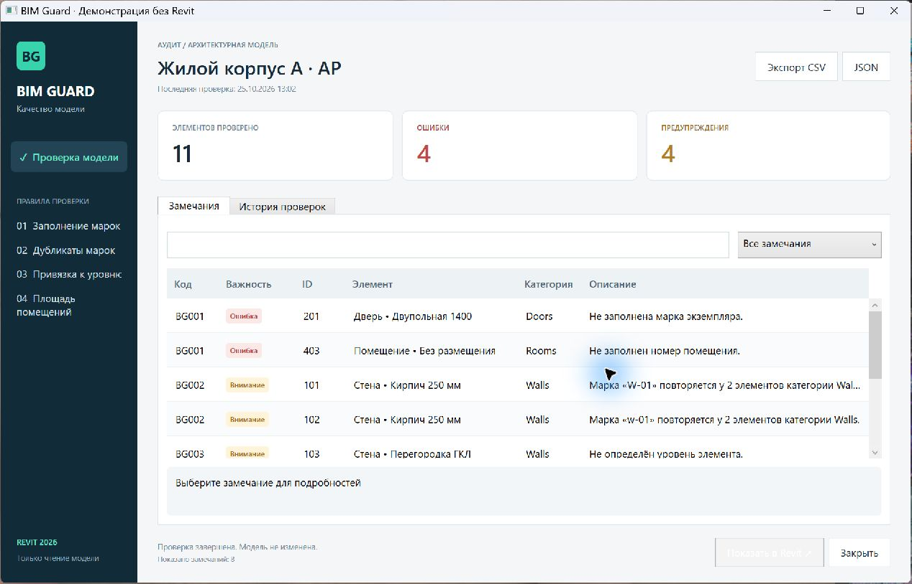

# BIM Guard

Плагин Autodesk Revit для проверки данных архитектурной модели. Находит незаполненные и повторяющиеся марки, элементы без уровня и помещения без площади. Результаты доступны в окне отчёта, сохраняются в истории и выгружаются в CSV или JSON.

**Версия:** 0.1.0 · **Revit:** 2026 · **Платформа:** Windows x64, .NET 8



## Возможности

- Проверка стен, перекрытий, дверей, окон и помещений активного документа.
- Поиск и фильтрация замечаний по важности, коду правила, категории, ID и описанию.
- Переход к выбранному элементу в Revit.
- История проверок документа в локальной SQLite.
- Экспорт отчётов в CSV/JSON и входных данных проверки в JSON.
- Автономная проверка JSON-снимков через WPF-приложение или командную строку.

Проверка и экспорт работают в режиме чтения модели.

## Правила проверки

| Код | Условие | Важность |
| --- | --- | --- |
| BG001 | Не заполнена марка экземпляра или номер помещения | Ошибка |
| BG002 | Марка или номер повторяется внутри одной категории | Предупреждение |
| BG003 | Не определён уровень элемента | Предупреждение |
| BG004 | У помещения нет положительной конечной площади | Ошибка |

При сравнении марок не учитываются регистр и пробелы по краям. Обязательность параметров следует согласовать с BIM-стандартом проекта. Проверка площади указывает на проблему размещения или границ помещения; причину нужно уточнить в модели.

## Установка и запуск

Распакуйте `BimGuard-Revit2026.zip`, закройте Revit и запустите скрипт из каталога пакета:

```powershell
.\Install-Addin.ps1
```

После перезапуска Revit на вкладке «Надстройки» появится панель **BIM Guard**. Откройте проект и нажмите **«Проверить модель»**.

[Подробная установка и сборка пакета](docs/INSTALLATION.md).

## Автономный запуск

Из корня исходников:

```powershell
# Открыть включённый пример в WPF-приложении
.\scripts\Run-Demo.ps1

# Выбрать JSON-снимок
.\scripts\Run-Demo.ps1 -ModelPath '--open'

# Собрать решение и выполнить все тесты
.\scripts\Test.ps1
```

Для сборки нужен SDK .NET 10.0.400. Приложение и плагин собираются под .NET 8. Требования и команды CLI описаны в [руководстве разработчика](docs/DEVELOPMENT.md).

Пример `samples/model-with-issues.json` содержит 11 проверяемых элементов, 4 ошибки и 4 предупреждения. В `samples/model-clean.json` — три элемента без замечаний.

## Документация

- [Руководство пользователя](docs/USER-GUIDE.md)
- [Установка и удаление](docs/INSTALLATION.md)
- [Сборка, тесты и CLI](docs/DEVELOPMENT.md)
- [Архитектура](docs/ARCHITECTURE.md)
- [Приёмочные сценарии Revit](docs/REVIT-ACCEPTANCE.md)
- [Протокол проверок](docs/VALIDATION.md)
- [История изменений](CHANGELOG.md)

## Ограничения версии 0.1.0

Проверяется активный документ. Связанные RVT не включаются; отбор по фазе, варианту конструкции и активному виду не выполняется. Автоматическое исправление параметров не предусмотрено.

История группируется по `Document.CreationGUID`. Копии исходной модели могут иметь общий ключ и попадать в одну историю.

Сборка и 76 автоматических тестов проходят, автономный WPF-интерфейс проверен на запуске. Приёмка загрузки и команд внутри Revit 2026 пока не выполнена. Состав проверок и ограничения контрольного прогона зафиксированы в [протоколе](docs/VALIDATION.md).
