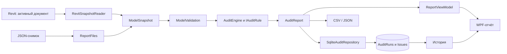
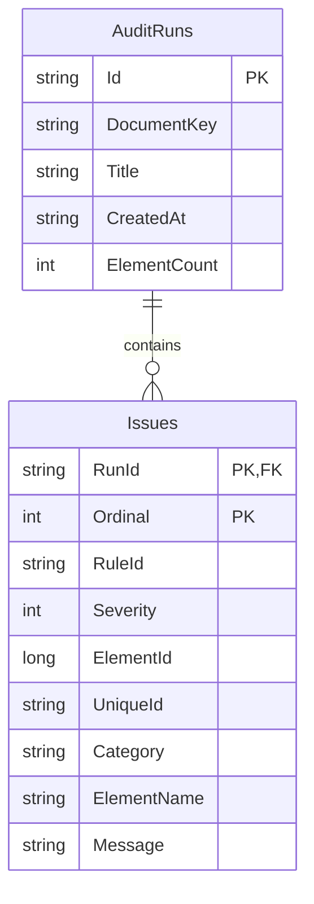

# Архитектура BIM Guard

## Поток данных

## Модули и зависимости

`Core` не содержит типов Autodesk, WPF и SQLite. Внешние команды преобразуют API-объекты в неизменяемые record DTO. Это позволяет проверять бизнес-правила без хоста и воспроизводить проблему на обезличенном JSON-снимке.

`IAuditRule` разделяет независимые проверки. Новое правило реализуется отдельно и регистрируется в `AuditEngine`; новый адаптер не требует переписывать существующие правила. Каждое замечание содержит стабильный код правила, важность и идентичность элемента.

`IAuditRepository` описывает требуемое поведение хранения. `AuditService` запускает проверку и сохраняет результат до показа пользователю. `SqliteAuditRepository` реализует контракт с параметризованными SQL-запросами.

`ReportViewModel` реализует `INotifyPropertyChanged` и тестируется без WPF. Фильтры изменяют только видимый набор замечаний; исходный отчёт и сводные счётчики сохраняются. Смена фильтра сбрасывает выделение, чтобы скрытый элемент не оставался целью навигации. Код окна отвечает за файловые диалоги и закрытие модального окна.

## Контекст Revit и транзакции

Сбор данных проходит в `IExternalCommand.Execute` на потоке Revit. Объекты `Document`, `Element`, `Parameter` не передаются в фоновые задачи. Коллектор ограничивается поддерживаемыми категориями до материализации и исключает типы элементов.

Правила используют `BuiltInCategory` и `BuiltInParameter`, а не локализованные имена параметров. У помещений считывается `Room.Number`; площадь переводится из внутренних единиц в м² через `UnitUtils`.

Команды проверки и экспорта имеют `TransactionMode.ReadOnly`. Окно модальное: команда не возвращает управление до его закрытия. Кнопка перехода передаёт только выбранное замечание. Затем команда ищет элемент по `UniqueId`, устанавливает выделение и вызывает `ShowElements`. Удалённый элемент или неразмещённое помещение обрабатываются отдельно. Для будущего немодального интерфейса потребуется `ExternalEvent`.

Демо-команда использует отдельную `Transaction`. Она отказывается работать при наличии поддерживаемых архитектурных элементов и запрашивает подтверждение перед созданием фрагмента. При исключении незафиксированная транзакция освобождается с откатом. Весь фрагмент можно отменить одним действием Undo. Это поведение требует фактической приёмки внутри Revit.

## База данных

- Версия схемы 1 создаётся в транзакции при первом открытии БД.
- Схема новее поддерживаемой отклоняется без попытки понизить её версию.
- Внешние ключи включаются для каждого соединения.
- Сохранение запуска и всех замечаний атомарно; тест провоцирует ошибку второй строки и проверяет полный откат.
- Даты хранятся в UTC в ISO 8601; WPF отображает локальное время.
- Индекс `(DocumentKey, CreatedAt DESC)` поддерживает чтение истории документа.
- Соединения открываются на операцию и закрываются через `using`; pooling отключён, чтобы не удерживать файл.
- SQLite подходит для локальной истории одного пользователя. Централизованное многопользовательское хранение потребует другого решения и политики миграций/доступа.

## Производительность и ограничения

Группировка марок использует хеш-группы вместо попарного сравнения. Проверки имеют линейную сложность относительно количества элементов; итоговая сортировка замечаний — O(M log M). DataGrid виртуализирует строки.

Снимок и отчёт находятся в памяти. В текущей версии сканирование и запись выполняются синхронно; измерений на большой реальной RVT-модели пока нет. Для больших моделей следующий шаг — профилирование, отмена, прогресс и перенос вычислений по DTO/БД за пределы UI-потока при сохранении API-операций в разрешённом контексте.

Сохранённый отчёт описывает состояние модели на момент запуска. Исторический отчёт не является доказательством, что текущая модель всё ещё содержит ту же ошибку.

## План развития

1. Профили проверок по BIM-стандартам и категориям, исключения для фаз и вариантов.
2. Контролируемое исправление параметров: предварительный просмотр, проверка доступа, транзакция, отчёт об изменениях.
3. Адаптер Navisworks для отчётов о коллизиях и согласованного сопоставления с Revit UniqueId.
4. Отдельный адаптер AutoCAD для проверки слоёв и атрибутов блоков.
5. Приёмочные тесты Autodesk-хостов на лицензированном агенте CI.

Перечисленные изменения запланированы для следующих версий.
